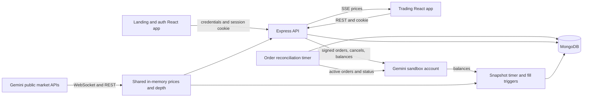

# BlueChip: technical review and implementation roadmap

Reviewed October 29, 2026. Scope: the working tree, including existing frontend changes. The review sections below record the baseline before implementation. The previously generated `docs/CODE_REVIEW_2026-10-29.md` was removed at the user's request after a reference search found no dependents.

## Implementation status — October 29, 2026

The first implementation stage now includes:

- Compatible security updates across all four lockfiles; subsequent production audits report zero known vulnerabilities for backend/dashboard/frontend. Remaining development-tool advisories are six low backend dependency entries and three moderate entries in each browser app; forced framework/test-runner downgrades were deliberately avoided.
- Exact sandbox-origin validation, an explicit test-only loopback override, validated timeout/cache/SSE settings, a byte-aware signup password limit, and conditional logout revocation.
- Durable pre-submission PENDING records, canonical payload hashes, globally distinct exchange client IDs, stored decimal instruction strings, UNKNOWN outcomes, lookup-based recovery, fair reconciliation scheduling, and failed-lookup backoff.
- Sandbox pair metadata/increment validation, bounded market prices, separate total/available cash, hold-change cache invalidation, freshness-aware valuations, and zero-position handling.
- Stable cursor history and open/pending filters, periodic/account-change refresh, truthful market-move estimates, actual timestamp spacing, explicit no-history states, stale-depth handling, and safe candle-switch failure behavior.
- Mobile navigation and a markets shortcut, real help content, delayed-state contrast correction, SSE backpressure/global caps, readiness/liveness endpoints, deterministic exchange-stub tests, root commands, and rollout documentation.
- Bounded atomic recent-order events, owner diagnostics, an explicitly allowlisted operator queue, safe lookup scheduling with cooldowns, persisted lookup error/attempt diagnostics, and process-local reconciliation health.
- Repeatable public sandbox/database checks and an isolated fixture dump/restore rehearsal. Executed external validation is recorded in `LIVE_VALIDATION_2026-10-29.md`; all required order indexes are now verified in the configured database; public deployment URLs remain unknown.

See [OPERATIONS.md](OPERATIONS.md) for additive fields/indexes, legacy migration precautions, API semantics, unresolved-order limitations, and local commands. No production database was migrated and no public deployment was performed. A later explicitly authorized live sandbox lifecycle check placed test-fund limit orders; all three test orders were cancelled unfilled. See `PREDEPLOYMENT_STATUS.md` for the latest evidence.

**Still pending:** separate submission/exchange state fields, a complete immutable audit ledger and investigated operator resolution workflows, trading exports, password-reset delivery, a general versioned migration ledger, complete observability metrics, production backup/restore drills, deployed-domain/proxy verification, and measured capacity/bundle optimization. The implemented timeline retains only 50 recent local events, and the operator action schedules original-order lookups without forcing state or resubmitting trades. The roadmap below remains the backlog; it must not be read as a claim that all 18 items are complete.

**Executed final verification:** `MONITORING_WEBHOOK_URL= npm run check` passed: all three production builds, 407 backend tests, 201 dashboard tests, 34 landing tests, and 27 Chromium browser tests — **669 tests total**. An additional isolated production-mode HTTPS deployment browser test passed, for **670 tests across both commands**. `git diff --check` and the root runner's JavaScript syntax check passed. Production-only npm audits reported zero known vulnerabilities for all three deployable apps. The dashboard main-chunk size warning remains. Browser tests use a local exchange stub; no live trading, production throughput, or deployed cookie behavior is claimed.

The diagnostics follow-up added eight real-database regression cases and seven dashboard cases for ownership, operator permissions, bounded events, stale observations, queue paging, safe lookup scheduling, failure deduplication/recovery, and UI error states. The real browser order journey now opens the activity page, verifies operator denial, scans accessibility, and checks phone-width overflow. Desktop/mobile screenshots were inspected. Public sandbox and configured MongoDB read checks passed; a generated-fixture dump/restore preserved data and the unique partial index. These checks do not validate signed sandbox writes or a deployed application.

Follow-up recheck reproduced and corrected additional edge cases: quote expiry during metadata/database waits; null exchange payloads; unlinked legacy rows blocking reconciliation; a background refresh leaving Orders loading; fractional execution prices displayed as cents; a partial limit fill described as cancelled; and an IOC partial execution described as rejected. Eight regression cases cover these paths. The follow-up full check passed all 640 tests and all three builds; the six cases first exercised before fixes reproduced their failures, then passed after correction.

Whole-project follow-up after credential setup reproduced and fixed four further groups: browser decimal instructions rounded before submission; null/empty/zero/negative execution prices becoming fabricated prices during reconciliation; missing BCH/ZEC coverage for default funded sandbox balances; and insufficient success-notification contrast during animation. Six new regression cases exercise the first three groups; the existing browser accessibility scan reproduced the notification failure. Live read-only balance/active-order requests passed, and the corrected normal price poll priced all five positive holdings with complete valuation. Runtime dependency audits were repeated and remain clean; development-tool advisories remain as listed above. No live exchange write or configured database mutation was performed.

Evidence labels used throughout:

- **Confirmed:** visible in source, reproduced locally, or measured by an executed check. Each finding identifies the kind of evidence.
- **Risk to test:** a plausible failure or deployment concern whose impact has not been established here.
- **Optional:** a product or engineering recommendation, not a defect.

## 1. Current Project Overview

BlueChip is an educational crypto trading application. Gemini executes orders on its sandbox matching engine using test funds. This backend integrates with that engine; it does not implement its own exchange or maintain independent per-user money ledgers.

| Application | Actual stack | Responsibility |
| --- | --- | --- |
| `frontend/`, port 3000 | React 19, TypeScript, Vite, React Router, Axios, Bootstrap CSS, custom CSS | Public pages, signup, login |
| `dashboard/`, port 3001 | React 19, TypeScript, Vite, Material UI, Chart.js, React Router, Axios | Prices, trading ticket, orders, holdings, funds, portfolio charts |
| `backend/`, port 3002 | Node.js, TypeScript, Express 5, Mongoose/MongoDB, bcrypt, JWT, ws | Authentication, API, Gemini integration, reconciliation, snapshots, SSE |
| `e2e/` | Playwright, axe, temporary MongoDB, exchange HTTP stub | Browser journeys, accessibility, runtime and rendering checks |

Dependencies and scripts were inspected rather than inferred from the MERN label. The browser projects declare Node `>=22.22.2`; README's Node 18 prerequisite is stale. The backend uses TypeScript 6 in its declared development dependencies; browser projects declare TypeScript 5.9. This is not itself a defect, but should be intentional and documented.

### Architecture and data flow

Market prices and candles default to Gemini's public production market-data endpoints; private orders default to Gemini's separate sandbox. Public and sandbox books are not guaranteed to match. The 1% IOC cross is an execution limit, not a guarantee of a market fill at the displayed public price.

Signup/login sets a 12-hour httpOnly JWT cookie. Dashboard `Home` verifies the session before rendering. Auth middleware also accepts bearer tokens. State-changing browser calls carry the custom CSRF header. MongoDB stores users, user-attributed orders, and shared portfolio snapshots. Gemini remains authoritative for money, holds, and execution.

All signed-in users trade against **one shared sandbox account**. They see shared balances, positions, and portfolio history, but `/api/orders` returns only their own orders. A new signup does not create a fresh funded trading account. This distinction is central to the UX and interview explanation.

Implemented functionality includes live prices, L2 depth, cached candle history, market orders emulated with IOC limits, resting limit orders, cancellation, periodic order synchronization, shared account views, snapshot history, session revocation, rate limits, structured logging, shutdown handling, CI, unit/integration tests, and browser checks.

Missing or incomplete functionality includes recovery of uncertain submissions, complete history navigation, account recovery, real help articles, a durable order audit trail, accurate cost-basis P/L, and operational readiness reporting. The code does not establish a live deployment, real users, verified production database settings, or production throughput.

## 2. Current Strengths and Weaknesses

### Strengths supported by source and executed tests

- `services/priceFeed.ts`, `geminiWs.ts`, and `sse.ts` centralize upstream market requests and stream one shared cache to users. This is a practical upstream-rate-budget design.
- `orderState.ts` uses conditional atomic updates so stale reconciliation/cancellation observations cannot blindly overwrite newer fills. The persistence integration suite tests actual Mongo behavior.
- `geminiPrivate.ts` signs requests with HMAC-SHA384, bounds requests, distinguishes credential failure, coalesces balance reads, and avoids automatic retries of exchange writes.
- Authentication uses hashing, httpOnly cookies, algorithm-pinned JWT verification, timing equalization for nonexistent users, and token-version revocation.
- Security is more developed than a basic CRUD project: CORS allowlisting, a custom CSRF header, body-size caps, several rate limits, Helmet, input shape checks, and sanitized Mongo filters.
- Portfolio history is downsampled in MongoDB rather than loading every snapshot into Node. Money totals use integer cents.
- UI already has design tokens, responsive layout rules, focus handling for dialogs, chart descriptions, loading placeholders, and touch-accessible trade actions.
- In this conversation, 352 backend, 185 dashboard, 34 landing, and 26 Chromium browser tests passed: **597 total**. All three production builds passed.

### Confirmed problems and their practical effect

| ID | Problem and evidence | Consequence | Principal source |
| --- | --- | --- | --- |
| C1 | Database record is created after exchange submission; isolated same-key concurrency check invoked the exchange twice | Local uniqueness does not protect the external side effect; timeout/write failure has no durable recovery record | [orderEngine.ts:102](/Users/souravgoyal/Desktop/BlueChip/backend/services/orderEngine.ts:102) |
| C2 | User limit `$0.0899` was sent as `$0.09` in a local module check | Buy maximums or sell minimums change silently | [orderEngine.ts:69](/Users/souravgoyal/Desktop/BlueChip/backend/services/orderEngine.ts:69) |
| C3 | USD total `amount` is returned as buying power; test fixture with 1000 total/100 available reported 1000 | Reserved cash is advertised as spendable | [account.ts:85](/Users/souravgoyal/Desktop/BlueChip/backend/services/account.ts:85) |
| C4 | A one-hour-old cached price still produced `complete: true` in a module check | Stale account values can be recorded as new history | [account.ts:88](/Users/souravgoyal/Desktop/BlueChip/backend/services/account.ts:88) |
| C5 | Two passes over 501 local resting orders repeatedly selected the oldest 500 | Newer filled orders can remain locally OPEN indefinitely | [orderSync.ts:33](/Users/souravgoyal/Desktop/BlueChip/backend/services/orderSync.ts:33) |
| C6 | Latest 100 orders are the only page; dashboard has no history cursor or open filter | Older orders and their cancel actions disappear from the UI | [OrderRoute.ts:59](/Users/souravgoyal/Desktop/BlueChip/backend/routes/OrderRoute.ts:59) |
| C7 | Summary/Funds fetch on mount, without subscribing to submission or fill changes | Account figures stay unchanged while trading from the watchlist | [Summary.tsx:34](/Users/souravgoyal/Desktop/BlueChip/dashboard/src/components/Summary.tsx:34), `Funds.tsx` |
| C8 | Book survives socket disconnect; UI ignores book timestamp | Outdated depth remains labelled live | `geminiWs.ts`, `orderBook.ts`, `shared/DepthPanel.tsx` |
| C9 | Engine transforms `GeminiUnavailableError` into `OrderError(502)`; reproduced | Route's intended setup-specific 503 is unreachable for placement | [orderEngine.ts:138](/Users/souravgoyal/Desktop/BlueChip/backend/services/orderEngine.ts:138) |
| C10 | USD 1000 plus unsupported XYZ 0 marked valuation incomplete in a module check | A nonexistent position hides totals and prevents snapshots | [account.ts:83](/Users/souravgoyal/Desktop/BlueChip/backend/services/account.ts:83) |
| C11 | Failed market/timeframe fetch keeps previous candle array | Old market data can appear under a new market heading | [MarketDetail.tsx:50](/Users/souravgoyal/Desktop/BlueChip/dashboard/src/components/MarketDetail.tsx:50) |
| C12 | Sandbox guard checks a substring; URL normalization accepts `https://api.gemini.com/sandbox/..` as a route to production | Misconfiguration can defeat the stated sandbox-only invariant; production-valid credentials would still be needed for production orders | [geminiPrivate.ts:16](/Users/souravgoyal/Desktop/BlueChip/backend/services/geminiPrivate.ts:16) |
| C13 | Signup allows 128 characters; bcrypt comparison accepted a different suffix after the first 72 bytes | Accepted password characters do not all contribute to authentication | `controllers/AuthController.ts`, `schemas/UserSchema.ts` |
| C14 | Help topics are plain list text; password reset is named but has no route or implementation | Support content implies workflows users cannot complete | `frontend/src/landing_page/support/CreateTicket.tsx`, `routes/AuthRoute.ts` |
| C15 | Summary multiplies current value by 24h return, calls it P/L, and draws history from values without timestamps | A 100→110 price move is reported as 11 per unit rather than 10; the figure is not acquisition-cost P/L; uneven snapshot times appear evenly spaced | `Summary.tsx:79`, `shared/chartPath.ts` |

C1 does **not** establish that Gemini filled two live orders. It establishes two application submissions and one local row against mocks. [Gemini documents client IDs as correlation identifiers and recommends uniqueness](https://developer.gemini.com/client-order-id); do not assume a durable replay guarantee. Recover by [status lookup using client ID](https://developer.gemini.com/trading/rest-api/orders/get-order-status) and keep ambiguous outcomes ambiguous until resolved.

## 3. Frontend and UI/UX Review

### Visual assessment

I inspected the current landing and dashboard renders locally at 1440×1000 and 375×812. The exchange HTTP responses were stubbed, so prices/balances in those screenshots are fixtures, not observed market/account facts. Inspection used reduced motion and allowed animations to settle. The earlier automated mobile and accessibility checks passed; automated scans are not full WCAG conformance evidence.

Keep the dark trading-terminal direction. The landing hero is already focused, the sandbox explanation is visible, and the dashboard uses consistent card, typography, and numeric patterns. A complete redesign would distract from the more important correctness work.

| Specific issue | Improvement and why | Files/components |
| --- | --- | --- |
| At 375px, navigation is a narrow horizontal scroller beside logo/profile; only part of the next route is visible | Use an explicit mobile navigation pattern, or clear overflow affordances. Make all four destinations discoverable without guessing | `Menu.tsx`, dashboard CSS |
| On mobile, the trade-entry watchlist is below the large portfolio chart | Add an obvious Markets/Trade entry point or collapsible market list near the top. The user's main action should not require scrolling past analytics | `Dashboard.tsx`, `WatchList.tsx`, dashboard CSS |
| Shared account is disclosed but the greeting and figures can still feel personal | Put “Shared sandbox account” next to balance/portfolio headings; distinguish “Your orders” from shared holdings and explain other traders can change them | `Summary.tsx`, `Funds.tsx`, `Holdings.tsx`, signup copy |
| Value history lacks time-axis context and may synthesize a flat baseline without history | Render real timestamps, a labelled time axis, and an explicit “No recorded history yet” state. Never imply a measured historical trend from a current balance | `Summary.tsx`, `chartPath.ts` |
| Estimates, spendable funds, and submission state are weakly connected | Ticket should show pair precision, available funds/asset, estimated notional, execution cap, and a persistent pending/unknown result. A transient toast is insufficient for uncertain execution | `useOrderTicket.ts`, `BuySellModal.tsx` |
| Market candles fetch only on market/timeframe change | Refresh visible charts on an interval appropriate to the timeframe; do not let an open market page freeze forever | `MarketDetail.tsx` |
| Error handling sometimes retains data without stating its age | Add shared Load/Error/Stale/Unavailable states and retry actions; preserve useful data with a visible timestamp | `Home.tsx`, `PricesContext.tsx`, `Summary.tsx`, `Orders.tsx`, `DepthPanel.tsx` |
| Help topics do not open explanations | Create concise real articles for IOC orders, partial fills, shared funds, and delayed data; remove unavailable reset claims until implemented | `support/CreateTicket.tsx`, `support/Hero.tsx` |
| Watchlist doughnut compares absolute price returns as slices of a whole | Prefer a signed horizontal movers list; absolute-return shares are not portfolio allocation and hide direction | `WatchList.tsx`, `DoughnoutChart.tsx` |
| Landing and dashboard have different fonts, radii, and token values | Share a small semantic token contract for brand, text, focus, spacing, status, and numeric typography. Preserve intentional marketing/terminal differences | both `src/index.css`, `dashboard/src/theme.ts`, `frontend/index.html` |

Retain existing `DataTable`, `StatCard`, `EmptyState`, `Skeleton`, `ConfirmDialog`, `useModalA11y`, and formatting helpers. Extract account-data hooks and chart loading logic where they are actually duplicated. Do not replace every page with a generalized component framework.

Accessibility follow-up: manually test full keyboard journeys, selected tabs and arrow-key behavior, modal dismissal during submission, screen-reader announcements of async results, focus after route transitions, zoom/reflow, and stale-state messaging. The mobile menu should be tested with touch as well as keyboard. Preserve reduced-motion support and do not add animation to continuously changing money values.

For performance, inspect a bundle report before choosing imports to optimize. The dashboard main chunk built at approximately 653 kB minified and 218 kB gzip in this session. Keep the existing lazy MarketDetail split; consider loading the decorative watchlist chart separately or removing it. Move test libraries out of runtime dependencies, remove unused CRA-era ESLint configuration after adding a real lint script, and verify whether Bootstrap JavaScript is still needed now navigation is React controlled. These are cleanup candidates, not proven runtime speedups.

## 4. Backend Review

### Appropriate target architecture

Keep an Express modular monolith and one backend process for the current deployment. Existing `routes/`, `services/`, `middlewares/`, `schemas/`, and `model/` separation is usable. Add a small order-persistence boundary where recovery logic warrants it; a repository class for every trivial query would add ceremony without solving a current problem.

`index.ts` currently combines app setup and boot behavior, with process-level handlers installed even on test import. Split reusable app construction from process bootstrap when changing startup/readiness. This makes middleware and lifecycle tests easier without changing deployment topology.

### Durable order submission proposal

1. Validate request shape and pair-specific decimal rules; canonicalize the payload without changing the user's limits.
2. Atomically create a submission intent unique on `(userId, clientRequestId)`, storing a payload hash and an exchange-compatible ID unique across the shared account.
3. Only the winning claimant submits. An existing intent with a different hash returns conflict; one with the same hash returns the existing outcome or pending state.
4. Use separate submission state (`PENDING`, `SUBMITTING`, `UNKNOWN`, `ACCEPTED`, `REJECTED`) and exchange order state (`OPEN`, `PARTIALLY_FILLED`, `FILLED`, `CANCELLED`, `REJECTED`).
5. A timeout or ambiguous network/5xx failure becomes UNKNOWN. Do not immediately resubmit simply because an initial status lookup returns not found; define a reconciliation window and escalation policy.
6. Recover by the persisted exchange client ID. Expired worker leases allow recovery work, not permission to blindly repeat an uncertain external write.
7. Reuse `applyObservation` for monotonic exchange updates. Persist an order-event entry with the meaningful transition so operations and users can explain what happened.

MongoDB transactions cannot include Gemini's HTTP matching engine. The promise should be durable intent, controlled submissions, and reconciled outcomes—not “exactly once across database and exchange.”

### API and domain changes

- Expose cursor-based history with validated `status`, `symbol`, and `side` filters. Keep a stable ordering on `(createdAt, _id)` and document cursor semantics.
- Standardize errors, for example `{error:{code,message,requestId,retryable}}`. Distinguish rejection, unavailable configuration, and unknown outcome. Never leak signing headers or raw credentials.
- Preserve GeminiUnavailableError and safe upstream reason codes through the service boundary. Do not classify every connection failure as a definite rejection.
- Introduce shared runtime request/response validation at the exchange boundary as well as the HTTP boundary. TypeScript casts do not validate JSON. Handwritten focused validators are acceptable; a schema library needs a concrete reuse benefit.
- Validate `clientOrderId` against the upstream-compatible format rather than accepting any string up to 100 characters. [Gemini documents 1–36 characters from a restricted set.](https://developer.gemini.com/client-order-id)
- Maintain a fair reconciliation cursor/last-check schedule. Bound private calls and back off on rate limits; repeated failures for old rows must not consume all lookup slots forever.
- Return total cash, available cash, valuation completeness, and price/balance observation times separately. Holds change on open/cancel events even when executed quantity is zero.
- Keep public market and private sandbox environment labels explicit. Validate supported trading pairs against the trading environment's metadata as appropriate, not just public production listing.

Role-based access control is unnecessary for ordinary traders today. Introduce a narrowly scoped operator role only with a real operations screen and audited administrative actions. Do not expose secrets, arbitrary exchange calls, migrations, or account resets as public demo features.

## 5. Database Review

MongoDB is appropriate for the existing document model. There is no demonstrated reason to switch databases. Most current records are user credentials, order observations, and time-stamped aggregate values; Gemini holds the execution ledger.

### Current model

| Collection | Purpose and existing protections | Weakness |
| --- | --- | --- |
| Users | ObjectId identity, unique normalized email, hashed password, creation date, token version | No recovery-token model; password policy exceeds bcrypt byte limit; schemas could constrain lengths and version invariants |
| Orders | User ref, symbol, side/type/status enums, quantities/prices, Gemini ID, client ID; user/date index and partial unique user/client index | Created too late for submission recovery; no submission state or reconciliation schedule; weak numeric cross-field constraints; no unique exchange-ID constraint |
| Snapshots | Integer-cent cash/value and timestamp index | No valuation freshness provenance; unrestricted retention; shared account identity implicit |

An ObjectId `ref` is not a foreign-key constraint. Account deletion must define what happens to attributed orders and audit history. Do not cascade-delete trading history by accident.

### Proposed incremental schema

| Collection | Add or clarify | Constraints/indexes |
| --- | --- | --- |
| Users | Current fields; optional verified-email and reset metadata only when implemented | unique email; bounded username/email; nonnegative integer tokenVersion; exclude password from ordinary reads with explicit select for login |
| Orders/intents | accountId, clientRequestId, exchangeClientOrderId, payloadHash, submissionState, requested decimal values, exchange state, exchangeOrderId, submittedAt, lastCheckedAt/nextCheckAt, lastSafeError, observation version | unique `(userId, clientRequestId)` for keyed requests; unique exchange client ID within account; partial unique `(accountId, exchangeOrderId)` where present |
| Order events | orderId, eventId/sequence, accountId, actor type/user, event type, from/to state, observed filled quantity, observedAt, recordedAt, requestId | unique event identity for deduplication; `(orderId, sequence)` for detail views; restricted write path |
| Snapshots | accountId, cashCents, holdingsCents/valueCents, valuationAt, price observation bounds, quality metadata | `(accountId, ts)`; reject invalid/stale valuation; define later rollup/retention policy |
| Password reset tokens, if added | userId, tokenHash, expiresAt, consumedAt | token hash unique; TTL cleanup; always check expiration and single-use atomically in the application |

Store decimal order prices/amounts as validated decimal strings or carefully encoded fixed-scale values appropriate to each pair; convert explicitly at integration boundaries. Keep integer cents for aggregate USD display totals, with finite/safe-integer checks. If adopting Decimal128, define API serialization and arithmetic rules rather than mixing BSON decimals and JavaScript floats casually.

### Query experiment actually executed

In a temporary MongoDB with 5,000 synthetic orders, the current resting-status query with the current `(status,type)` index examined 4,000 documents to return 500 and used a blocking SORT. Adding `(status,createdAt)` in that temporary database examined 500 documents for 500 results and used index-based merge ordering.

This supports an index change; it is **not** a production latency benchmark and the candidate index was **not** added to the application. The final fair-scheduling query may use `(status,nextCheckAt,_id)` instead. Measure that final query and the paginated history query with representative fixtures. [MongoDB's explain documentation](https://www.mongodb.com/docs/manual/tutorial/analyze-query-plan/) describes the relevant examined-key/document statistics.

The `(userId,createdAt)` history index is a useful starting point; add `_id` for stable cursors and add other filter indexes only after measuring actual query shapes. Bounded response points do not make the ALL-history aggregation constant-cost: `$bucketAuto` still processes matched history. Consider daily rollups only when observed history volume warrants them.

### Migrations, consistency, and recovery

`migrations.ts` is a gated one-shot destructive cleanup, not a general versioned migration framework. Keep its safeguards; add a migration ledger and separate expand/backfill/verify steps for new order fields. Inspect duplicates before building new unique indexes. A failed required index postcondition should fail deployment rather than only log an error.

Use single-document atomic updates for order claims and versioned state. Use a Mongo transaction only when an order update and separate event insertion must commit together; that requires a compatible replica-set test/deployment setup. An embedded bounded event list is an alternative for a small system, but avoid unbounded order documents.

Existing orders should be backfilled as accepted/observed records, not resubmitted. Preserve their original IDs and recorded prices; do not rewrite historic trades to match a new precision rule. Pause unsafe writes during any uniqueness migration that cannot be made compatible with live traffic.

Production credentials, effective indexes, database role permissions, backup retention, restore tests, and network restrictions were not inspected. Specify a least-privilege app account, a separate migration identity, a documented recovery point/time objective, and an executed restore exercise. Do not infer those controls from `.env.example`.

## 6. Recommended Features

Select features that extend the application's central trading workflow. Existing authentication, SSE, caching, API integration, and background tasks already supply substantial depth; do not add them again under new names.

| Feature | Priority/difficulty | User benefit and resume value | Frontend / backend / database changes |
| --- | --- | --- | --- |
| Durable order status and event timeline | Essential / Hard | Makes uncertain execution understandable; demonstrates state machines, recovery, concurrency, and auditability | Persistent pending/unknown ticket and detail view / claim-and-reconcile flow and events API / intent fields, unique IDs, ordered events |
| Searchable, filterable, paginated orders | Essential / Medium | Every resting order stays reachable; demonstrates API contracts, index design, and stable cursors | Orders filters, pagination, open view / validated cursor endpoint / aligned compound indexes |
| Reconciliation operations view | Recommended / Medium | Helps an operator diagnose stuck orders without editing the database; demonstrates observability and least privilege | Operator-only queue/status view / protected read endpoints and controlled retry-reconciliation action / next-check/error/event metadata |
| Trading activity CSV export | Recommended / Medium | Users can examine their own fills; demonstrates ownership checks, streaming, and safe export handling | Export current filters / bounded or streamed export / reuse indexed order query; neutralize spreadsheet-formula cells |
| Account recovery | Recommended for public signups / Medium | Recovers access to personal order history; demonstrates expiring, hashed, single-use tokens and session revocation | Reset screens / generic-response request and redeem endpoints plus mail adapter / hashed token, expiry, consumption, tokenVersion bump |
| Saved market watchlist and price alerts | Optional / Medium | Personalizes the shared-account experience without pretending money is per user | Favorite toggles and alert settings / preferences and deduplicated alert evaluation / unique user-symbol preference and alert rules |

No uploads or AI feature is needed for the stated product. A local simulated per-user ledger would be a substantial separate product mode; do not bolt one onto the shared Gemini account while continuing to claim per-user exchange balances.

## 7. Security, Performance, and Testing Review

### Executed checks

The test/build results below were executed earlier in this same conversation against the current application source, not inferred from CI badges. This phase changed documentation only, so they were not rerun unnecessarily.

| Check | Result |
| --- | --- |
| Backend Jest | 24 suites, 352 tests passed |
| Dashboard Vitest | 21 files, 185 tests passed |
| Landing Vitest | 9 files, 34 tests passed |
| Chromium Playwright | 26 tests passed |
| Three TypeScript/production builds | Passed |
| Desktop/mobile visual inspection | Four local renders captured; desktop landing/dashboard and mobile dashboard examined |
| bcrypt suffix reproduction | Different suffix after identical first 72 bytes authenticated |
| Temporary database query experiment | Current scan/sort compared with candidate index, as described above |

The full browser suite includes accessibility scans, mobile checks, sign-up/trade/list journey, session reload/logout, route runtime checks, and chart rendering checks. It uses a stub exchange and same-site loopback origins. It does not establish live Gemini behavior, cross-site cookie reliability, load capacity, or deployment availability.

### Dependency audit run in this phase

`npm audit --json` and, for deployable apps, `npm audit --omit=dev --json` queried the current advisory service without installing updates.

| Lockfile | All dependency findings | Production-dependency findings |
| --- | --- | --- |
| backend | 16: 2 critical, 5 high, 3 moderate, 6 low | 4: 1 critical, 1 high, 2 moderate |
| dashboard | 7: 4 high, 3 moderate | 1 high |
| frontend | 7: 4 high, 3 moderate | 1 high |
| e2e | 1 high | Not assessed separately; test tooling |

These are npm's vulnerable dependency entries, including derived dependency relationships, not necessarily distinct CVEs or demonstrated BlueChip exploits. Backend findings include `body-parser`, `proxy-addr`, `qs`, and `ip-address`. Advisory relevance differs by call path and configuration. Browser lockfiles include `follow-redirects`, whose Node adapter behavior is not automatically reachable in static browser bundles.

Prioritize a compatible patched dependency tree and verify the parser/proxy paths. The [body-parser compressed-body advisory](https://github.com/advisories/GHSA-27r3-jxmh-p828) is relevant to a server accepting JSON before authentication. The [proxy-addr advisory](https://github.com/advisories/GHSA-jqcg-44mw-7w3h) concerns a trust-subnet path; this application configures hop-count trust, so its stated critical severity must not be misrepresented as a proven IP-spoofing exploit here. Do not blindly accept `npm audit fix --force` suggestions, including framework/test-runner downgrades.

### Security actions and boundaries

- **Confirmed:** bcrypt ignores bytes after 72; signup currently measures characters up to 128. Reject new over-limit UTF-8 passwords with clear feedback, or adopt a versioned hash migration. Do not casually block legacy logins and strand existing users. [bcrypt's own documentation explains the byte limit.](https://github.com/kelektiv/node.bcrypt.js/)
- **Confirmed:** exact sandbox origin validation is missing; enforce origin/protocol/path constraints and allow local stubs only in explicit test mode.
- **Confirmed:** API response validation is largely compile-time casting; validate external payloads before writing terminal order states.
- **Risk to test:** actual proxy topology versus `trust proxy = 1`, forwarded-header handling, and rate-limit behavior at the deployed edge.
- **Risk to test:** split-domain authentication under browser third-party-cookie restrictions; prefer a same-site custom-domain arrangement and test actual HTTPS origins.
- **Risk to test:** an old revoked but unexpired token can still increment tokenVersion in Logout, because that handler does not condition the update on the presented version. Make revocation conditional/idempotent and test replay.
- **Optional hardening:** select only needed user fields outside login, add a consistent API error handler, add a deployment-specific CSP to the static apps, and track dependency/secret scanning in CI. Backend Helmet does not set headers on separately hosted HTML.

### Reliability and performance actions

- Add `/livez` for process liveness and `/readyz` for DB/dependency readiness; expose safe degraded-service status separately. `/healthz` currently always returns HTTP 200 and `ok: true`, regardless of price availability. Do not fail process liveness merely because a market feed is temporarily down.
- Report last successful sync, reconciliation backlog, oldest unknown submission, per-symbol data age, balance-fetch errors, and snapshot age. Alert on actionable thresholds and repeated failures, not every transient request.
- Bound global SSE resources and handle `res.write()` backpressure. Returning false is a buffer-pressure signal, not an exception; current catch-only logic does not establish slow-client safety. Verify with a slow-reader load test before asserting a memory leak in production.
- Coalesce simultaneous candle-cache misses; per-IP limits alone do not prevent many clients from fetching the same cold key upstream.
- Use per-symbol freshness. `isPayloadFresh` currently checks the newest cached price, so one active symbol can keep the global live indicator green while others are old.
- Validate numeric environment settings explicitly. `Number(env) || default` prevents documented zero values from disabling the balance TTL, and negative values can slip through other settings.
- Keep one instance until nonce ordering, reconciliation ownership, shared cache, rate-limit state, and SSE fan-out are deliberately externalized. Redis or a queue is a later response to measured needs, not a prerequisite for this demo.
- Run deliberate SIGTERM tests during an in-flight order/reconciliation operation. HTTP draining exists; stopping timers alone does not prove that already running background promises drain before DB disconnect.

### Required regression scenarios

Use meaningful behavior tests: same-key concurrent submits; key reused with changed payload; accepted-but-response-lost; process restart before local acknowledgment; upstream duplicate-ID conflict; unresolved lookup windows; DB write failure after acceptance; pair precision/minimums; partial-fill/cancel races; 501+ resting rows; old failed lookups not starving newer work; pagination ties; open orders outside newest history page; reserved funds on place/cancel; stale and missing prices; zero positions; setup-specific order errors; password bytes and session replay; wrong-market chart retention; two-user shared-account updates; SSE backpressure; and deployed cookie/proxy behavior.

Measure API latency distributions, upstream request counts, event-loop delay, SSE memory, and query plans with documented fixtures. Record reproducible commands and environment before making performance claims. Avoid adding coverage-percentage gates until actual coverage is measured and meaningful uncovered paths are understood.

## 8. Resume and GitHub Evaluation

### Hiring assessment

This is already suitable for an entry-level resume if described honestly. It is stronger than a basic CRUD app because it integrates signed exchange writes, two streaming boundaries, asynchronous order state, concurrent observations, database indexes, integration tests, browser tests, and deployment configuration.

It is not yet appropriate to advertise as a production-grade trading platform, a matching engine, a personal brokerage, or an exactly-once execution system. The biggest weaknesses are failure recovery and financial-data truthfulness, followed by incomplete product flows and stale documentation. Recruiters may first notice a polished demo; an engineering interviewer will care whether you can explain the edge cases yourself.

The greatest three improvements for engineering depth are durable order recovery, exact order/available-funds semantics, and an indexed order history plus audit timeline. Dependency/security corrections are release prerequisites even when they are less visually impressive.

### Repository and documentation changes

- Keep the name **BlueChip** consistently. Add a short repository description and topics; add a live demo link only once verified. Do not claim deployment from the presence of Render/Netlify configuration.
- Lead README with the product problem, shared sandbox model, a current screenshot, a 60–90 second scenario, and a compact architecture diagram.
- Correct stale README claims: Node 18, per-signup 100k seeding, a local matcher in demo alt text, polling-only dashboard language, and “no DB needed” now that persistence suites use temporary mongod.
- Update PROJECT_GUIDE's obsolete test counts and statements that a client key guarantees safe retries. Link detailed implementation notes rather than maintaining multiple conflicting counts in prose.
- Document collections, indexes, order/submission state machines, and why a DB transaction cannot make an exchange HTTP call atomic. Add short ADRs for shared funds, SSE, IOC emulation, MongoDB, decimal representation, and single-instance scope.
- Add an OpenAPI contract with error and pagination examples, including 202/pending or unknown outcomes if implemented. Preserve old routes until callers migrate; renaming auth endpoints is lower priority than correctness.
- Provide root-level setup/check scripts or a small npm workspace and a lockfile strategy. Use a supported pinned Node runtime across docs, CI, and hosts. Add a deterministic exchange-stub demo mode so reviewers do not need private sandbox credentials.
- Keep environment examples synchronized with validated configuration; document same-site hosting, optional monitoring destination, and migration flags. Never include real secrets.
- Add lint/format scripts and CI checks; remove dead CRA config after replacement. Use `npm ci` for deterministic deployment once compatible with the host build setup.
- Keep commits focused on final user-visible or operational behavior and its regression test. Recent commits are reasonably focused, but several titles are conversational; explain the invariant or failure being fixed.
- Resolve license inconsistency: README restricts commercial use, backend/dashboard say ISC, and no standalone LICENSE was found. Choose and document the owner's intended license rather than assuming one.

### Three accurate resume bullets for the current project

1. Built a TypeScript crypto trading application with React, Express, and MongoDB, integrating HMAC-SHA384-signed Gemini sandbox orders, cancellations, and background order reconciliation.
2. Implemented a shared market-data pipeline using Gemini WebSocket feeds, REST fallback, cached prices, and Server-Sent Events to power live watchlists, order-book depth, and candlestick views.
3. Developed automated validation across Jest, Vitest, and Playwright, with 597 passing tests covering backend logic, MongoDB persistence, browser trading journeys, session handling, accessibility scans, and rendering behavior.

Use the test count only with a dated passing run and ownership consistent with the work you can explain. Do not claim measured production scale or a percentage latency improvement. After shipping durable recovery, replace part of the first bullet with the implemented recovery invariant and its restart/concurrency tests.

### Interview preparation

Be ready to answer:

1. Why are balances shared but orders scoped to users? What does the UI disclose?
2. Why does an IOC limit emulate a market order, and what can prevent it filling?
3. Why does a unique Mongo index not prevent duplicate exchange side effects?
4. What do you do when the exchange accepted an order but the HTTP response disappeared?
5. How do cancellation and synchronization avoid overwriting newer fill information?
6. Why are order-price decimals different from aggregate USD cents?
7. How would you design a stable cursor and prove its index is used?
8. Why SSE to browsers, and how do you handle reconnects, stale data, and slow readers?
9. Why do cookies work locally but fail on unrelated deployed domains?
10. What breaks with two backend replicas, and which state would you move first?
11. What do mocks establish, and what requires a real database or live exchange contract check?
12. How would you restore the database and recover pending exchange submissions after a crash?

The completed project should demonstrate one coherent product workflow, correct state transitions, tested recovery, measurable database behavior, secure account handling, transparent limitations, and a reproducible demo. That supplies better interview material than a longer list of unrelated features.

## 9. Prioritized Implementation Roadmap

Difficulty is relative effort, not a delivery-date promise. Every item should be a small reviewable change or explicitly divided into compatible migrations. New dependencies are not required unless listed.

### Priority 1 — Critical

**P1.1 — Patch and verify vulnerable dependencies.** Problem: executed audit reports affected runtime and tool dependencies. Solution: triage advisories, update compatible direct/transitive packages, inspect lockfile changes, avoid force downgrades. Files: four package manifests/lockfiles, CI, parser setup if needed. Technology: existing npm; no new library. Difficulty: Medium. Impact: removes known affected versions and clarifies remaining exposure. Dependencies: none. Done: all three builds and existing suites pass, production advisory report is clean or has a documented reviewed exception with an owner and rationale.

**P1.2 — Enforce configuration and password invariants.** Problem: substring sandbox guard, permissive numeric parsing, bcrypt truncation. Solution: centralized startup configuration validation, exact origin guard with explicit test-stub allowance, new-password UTF-8 byte policy and a legacy transition. Files: `geminiPrivate.ts`, `AuthController.ts`, `UserSchema.ts`, `.env.example`, `index.ts`, e2e stub configuration. Technology: Node URL/Buffer and existing bcrypt. Difficulty: Medium. Impact: safer deployment and truthful authentication. Dependencies: none; coordinate dependency/runtime changes with P1.1. Done: production/attacker origins, invalid settings, zero TTL, multibyte/over-limit passwords, and legacy login behavior have focused tests.

**P1.3 — Define submission states and add compatible persistence.** Problem: no durable intent before external writes. Solution: canonical payload, stable request ID/hash, exchange-compatible ID, unique intent claim, pending/unknown fields and migration. Files: `OrdersSchema.ts`, new versioned migration, `orderEngine.ts`, shared types, API contract. Technology: existing Mongoose atomic operations; decimal validator/helper. Difficulty: Hard. Impact: foundation for crash recovery and safe retries. Dependencies: P1.2 configuration guard; design the decimal contract with P1.5 before persisting new payloads. Done: concurrent claims produce one owner, same key/different payload conflicts, old orders are backfilled without resubmission, required indexes are verified.

**P1.4 — Implement uncertain-outcome reconciliation and fair scheduling.** Problem: timeout gaps and oldest-500 starvation. Solution: submit only claimed intents; classify ambiguous failures; reconcile by persisted client ID; rotate due orders with backoff and durable timestamps. Files: `orderEngine.ts`, `geminiPrivate.ts`, `orderSync.ts`, `orderState.ts`, `lifecycle.ts`, integration tests. Technology: existing service timers and DB; no queue initially. Difficulty: Hard. Impact: prevents silent tracking loss and makes progress after restart. Dependencies: P1.3 and P1.5's validation contract. Done: accepted-response-lost, restart, lookup uncertainty, 501+ rows, repeated failed lookups, and SIGTERM fixtures resolve or remain visibly UNKNOWN without blind resubmission.

**P1.5 — Correct order precision and upstream error contracts.** Problem: cent-rounded limits, global quantity scale, incompatible client IDs, swallowed availability errors. Solution: load pair rules, validate decimal values without changing bounds, validate exchange responses, preserve actionable safe error codes. Files: `symbols.ts`, `gemini.ts`, `geminiPrivate.ts`, `orderEngine.ts`, `money.ts`, `OrderRoute.ts`, ticket. Technology: focused decimal handling; add a decimal library only if explicit arithmetic needs justify it. Difficulty: Medium–Hard. Impact: submitted instructions match the user's intent. Dependencies: design alongside P1.3; implement before enabling the new submit path. Done: low-price buy/sell limits are unchanged, invalid increments/minimums fail locally, market caps respect direction, absent credentials yield intended 503, and malformed responses cannot falsely make an order terminal.

**P1.6 — Fix cash availability and valuation quality.** Problem: total/available conflation, stale prices, zero unsupported balances. Solution: separate cashTotal/cashAvailable, include observed times, price only real positions with fresh quotes, invalidate hold changes, reject invalid snapshots. Files: `account.ts`, `geminiPrivate.ts`, `snapshots.ts`, `AccountRoute.ts`, dashboard Account/Holding types. Technology: existing cache and integer-cent helpers. Difficulty: Medium. Impact: balances and history stop implying false certainty. Dependencies: stable error/decimal contracts from P1.5. Done: place/cancel holds update availability, stale/missing prices are explicit, zero rows do not invalidate totals, and invalid valuations never enter history.

### Priority 2 — High Impact

**P2.1 — Add indexed cursor history and an open-order view.** Problem: 100-row truncation hides older cancel controls. Solution: stable cursor, status/symbol/side filters, accessible pagination. Files: `OrderRoute.ts`, `OrdersSchema.ts`, `Orders.tsx`, `DataTable.tsx`, OpenAPI. Technology: existing Mongo and React. Difficulty: Medium. Impact: complete order control/history. Dependencies: P1.3 schema contract; align indexes with P1.4 scheduling. Done: 250+ fixture orders with tied timestamps paginate without gaps/duplicates; an old open order is reachable and cancellable; ownership checks hold.

**P2.2 — Share refreshed account and order state.** Problem: Summary/Funds retain mount-time data; new fills from other users are unseen. Solution: a small shared account provider/hooks with invalidation on order events and bounded background refresh. Files: `GeneralContext.tsx`, `Summary.tsx`, `Funds.tsx`, `Holdings.tsx`, `useOrderTicket.ts`, account hook. Technology: existing React context first; consider a query library only if complexity warrants it. Difficulty: Medium. Impact: UI reflects completed and shared-account activity. Dependencies: P1.6 response contract. Done: two-user fixtures update money/positions without route reload; pending requests cannot overwrite newer responses; errors retain explicitly dated data.

**P2.3 — Correct market freshness and chart truthfulness.** Problem: stale depth, wrong-market retained candles, frozen candle views, value-only history spacing, misleading P/L. Solution: key data by market/timeframe, visible data age, bounded refresh, timestamp-aware history, explicit no-history state; label current-basket 24h movement as an estimate until real cost-basis analytics exist. Files: `PricesContext.tsx`, `MarketDetail.tsx`, `DepthPanel.tsx`, `Summary.tsx`, `chartPath.ts`, `orderBook.ts`, `geminiWs.ts`. Technology: existing charts/SVG. Difficulty: Medium. Impact: users can trust the meaning and age of the display. Dependencies: P1.6 and P2.2. Done: disconnect, individual-symbol staleness, failed route switch, irregular history times, and known 100→110 examples render correctly.

**P2.4 — Add readiness, safe errors, and failure observability.** Problem: always-green health and incomplete operational context. Solution: split app/bootstrap, liveness/readiness/status endpoints, consistent errors/request IDs, backlog/age indicators, conditional logout revocation, alert tests. Files: `index.ts`, new bootstrap/config/error middleware, `logger.ts`, `AuthController.ts`, deployment config. Technology: existing logger; optional host log drain. Difficulty: Medium. Impact: failures become visible and diagnosable. Dependencies: P1.4 submission states and P1.6 freshness fields. Done: DB/feed failures are distinguishable, readiness changes correctly, logged secrets remain redacted, and captured revoked-token logout cannot invalidate a new session.

**P2.5 — Improve mobile trade/navigation and complete help content.** Problem: narrow menu discoverability, watchlist below analytics, inert help topics. Solution: mobile navigation, obvious Trade entry, real help articles, consistent shared-account labels and error/retry states. Files: `Menu.tsx`, `Dashboard.tsx`, dashboard CSS, support pages, signup/login copy. Technology: existing React/CSS. Difficulty: Medium. Impact: coherent product workflow at phone and desktop sizes. Dependencies: stable pending/unknown states from P1.4 and refreshed data from P2.2. Done: complete keyboard/touch signup→trade→pending→orders→cancel journey at phone/tablet/desktop widths; help topics open accurate content; regression axe scans pass.

**P2.6 — Make setup, migrations, and deployment reproducible.** Problem: stale docs/runtime requirements, ad hoc migration history, no confirmed restore/deployed-domain test. Solution: root scripts, pinned runtime, deterministic stub mode, migration ledger/postconditions, same-site deployment runbook and backup/restore exercise. Files: root tooling/README, PROJECT_GUIDE, migrations, `.github/workflows/ci.yml`, Render/Netlify configs. Technology: npm and existing CI; optional local Mongo container. Difficulty: Medium. Impact: reviewers and maintainers can actually run and recover the system. Dependencies: complete P1 contracts first. Done: clean checkout follows documented commands, required indexes exist after migration, prior schema data survives, deployed HTTPS auth is verified, restore exercise is recorded.

### Priority 3 — Resume Differentiators

**P3.1 — Add order event timeline and operations diagnostics.** Problem: transitions and unresolved orders are difficult to explain. Solution: deduplicated state-change events, order details, restricted backlog diagnostics and reconciliation actions. Files: new event schema/service, orders APIs/UI, protected operator endpoints. Technology: Mongo transaction only if separate order/event atomicity is required; otherwise justify bounded embedding. Difficulty: Medium–Hard. Impact: strong demonstration of state machines, auditing, and operational engineering. Dependencies: P1.4, P2.1, P2.4. Done: every meaningful transition has actor/observation/time context; replayed observations do not duplicate events; unauthorized users cannot access other users' or operator-only data.

**P3.2 — Add filtered trading activity exports.** Problem: users cannot inspect their history outside the app. Solution: server-side bounded/streamed CSV matching owned order filters; explicit units/UTC timestamps and spreadsheet-cell safety. Files: order query/export service, `OrderRoute.ts`, `Orders.tsx`, API docs. Technology: Node streaming or a justified small CSV serializer. Difficulty: Medium. Impact: useful API/data-handling feature. Dependencies: P2.1 and final decimal representation. Done: export includes all matching owned rows across pages, excludes other users, handles special characters safely, and bounds resource use.

**P3.3 — Implement account recovery if public accounts remain enabled.** Problem: reset is promised but absent. Solution: hashed one-use reset tokens, generic request responses, expiry checks/rate limits, password change and session revocation. Files: auth routes/controller, token schema, frontend reset views, mail adapter, env docs. Technology: one email delivery provider only when chosen; local fake-mail adapter for tests. Difficulty: Medium. Impact: complete account lifecycle. Dependencies: P1.2 password policy and P2.4 errors/revocation. Done: expired/reused tokens fail, valid redemption is atomic, no reset secret is logged, and all old sessions are rejected afterward.

**P3.4 — Publish reproducible reliability/performance evidence.** Problem: current scale claims would be guesses. Solution: an isolated fixture/load harness, query-plan records, slow SSE clients, restart/recovery tests, and measured deployment-domain behavior. Files: tests/benchmark scripts, docs, CI optional job, service instrumentation. Technology: existing Playwright/Node initially; add a load tool only for a defined experiment. Difficulty: Medium. Impact: substantive backend/database interview material. Dependencies: P1 and P2 correctness work. Done: commands, fixture sizes, environment, raw results, and limitations are recorded; no benchmark is presented as production traffic.

### Priority 4 — Optional Polish

**P4.1 — Consolidate design tokens and reduce decorative weight.** Problem: duplicate tokens and decorative movers chart add inconsistency/dependency weight. Solution: shared token contract, signed movers view, consistent buttons/spacing, measured lazy loading, real screenshots. Files: both CSS files, theme, WatchList, chart imports, README media. Technology: existing CSS/Vite; optional temporary bundle analysis. Difficulty: Easy–Medium. Impact: more cohesive UI and potentially smaller initial download. Dependencies: P2.5 navigation settled. Done: before/after bundle output recorded, touch/keyboard/contrast checks preserved, and core flows unchanged.

**P4.2 — Add saved watchlists only after the core workflow is reliable.** Problem: shared funds limit useful personalization. Solution: user-owned favorite pairs; add price alerts only with deduplication and clear delivery semantics. Files: user preferences schema/routes, WatchList, optional alert service. Technology: current Mongo/React. Difficulty: Medium. Impact: modest product differentiation. Dependencies: P2.2 refresh and P2.4 observability. Done: preferences survive login and remain user-scoped; alert restart/repetition behavior is tested if alerts are included.

### Incremental execution rules

Use compatibility-first schema additions, then backfill, verify, switch callers, and only later remove old fields. Each change should state its invariant and validation. Keep existing frontend edits intact. Run focused tests while iterating and the affected app's typecheck/build after each substantial change; run all suites and browser journeys before integrating cross-app changes. Add an actual replica-set test fixture if transactions are introduced. Do not mix a broad UI rewrite with the order migration.

## 10. Final Recommendations

The first five work packages should be:

1. Patch affected dependencies and enforce exact sandbox/password/configuration invariants.
2. Define and persist order intent before exchange submission, then recover uncertain outcomes with fair reconciliation.
3. Preserve pair-specific decimal instructions and correct total/available cash plus valuation freshness.
4. Make every order reachable and keep dashboard/account/chart data current and correctly labelled.
5. Add a small event timeline, operational health view, reproducible demo, and accurate documentation to demonstrate the engineering work.

This keeps React, Express, MongoDB, the sandbox integration, and the existing deployment shape. The intended outcome is a dependable educational trading product with explainable failure behavior and evidence an interviewer can inspect.
